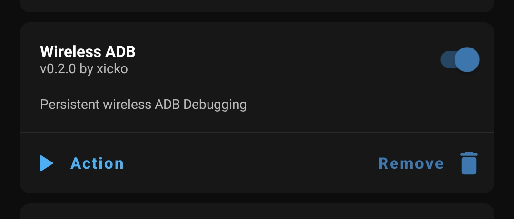

# Wireless ADB Magisk

Expose persistent wireless ADB debugging port via Magisk module, requires root.

## Configuration

A configuration file is autogenerated in `/data/adb/wireless_adb.conf`

```
port=5555
allowTailnetOnly=false
```

After modifying, open Magisk Manager app and run the module action to apply changes.

